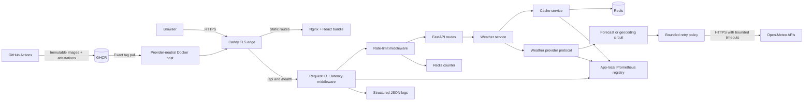

# Architecture

## Phase 7 production runtime

The repository is a modular monorepo with independently testable web and API
applications. Docker Compose supplies a reproducible local environment while
each application can also run directly on the host.

The production Compose project is separate from development. Caddy is the only
service with host ports and maintains HTTPS state in persistent volumes. Nginx,
FastAPI, and Redis have no source mounts or public ports. Edge traffic reaches
web and API on one network; Redis is isolated with API on an internal data
network. This makes the browser's API origin relative and removes deployment-time
cross-origin coupling.

## Boundaries

- `apps/web` owns browser rendering and frontend server state.
- `apps/api/app/api` owns versioned HTTP routing and dependency wiring.
- `apps/api/app/services` owns application use cases.
- `apps/api/app/cache` owns keys, serialization, freshness, metrics, Redis, and
  request coalescing.
- `apps/api/app/providers` owns the provider protocol and Open-Meteo translation.
- `apps/api/app/observability` owns structured logs, request correlation, and
  low-cardinality metrics.
- `apps/api/app/schemas` owns stable application-facing contracts.
- `infra/docker` owns container build definitions.
- `infra/caddy` and `infra/nginx` own production edge and static-origin policy.
- `compose.production.yml` owns the portable production topology and hardening.
- `docs` records current behavior and decisions.

The service uses cache-aside reads. Fresh Redis values return immediately.
Stale weather values are retained but used only after a provider failure. Cache
I/O failures fall through to Open-Meteo. Same-key misses are coalesced within
each API process and recheck Redis after acquiring the lock.

The browser treats FastAPI as its only weather data source. TanStack Query owns
location and forecast request state and cancellation. The API remains canonical
in Celsius, km/h, and millimeters; pure frontend formatters apply the selected
display units without issuing redundant weather requests.

Transient provider calls are retried inside their operation-specific circuit.
One exhausted logical call records one circuit failure. An open circuit fails
fast until its recovery interval permits one half-open probe. `WeatherService`
continues to own the stale-data decision, so resilience transport policy cannot
silently serve stale location or expired weather data.

Rate limiting runs before versioned routes and uses an atomic Redis fixed-window
counter. If Redis fails, the limiter falls back to a process-local counter so a
cache outage neither disables the API nor removes all abuse protection.

The request observability middleware validates or creates a request ID, measures
end-to-end latency, and records the resolved route template and response status.
Cache and provider boundaries record bounded results without exposing queries,
coordinates, payloads, or cache keys. Each application owns an isolated
Prometheus registry, which keeps tests deterministic and makes the future
multi-worker deployment choice explicit.

## Deployment boundary

Production images use read-only root filesystems, non-root API/web users,
dropped Linux capabilities, explicit temporary filesystems, health checks, and
immutable application contents. Redis receives its password through a file
secret, keeps AOF data on a named volume, and evicts least-recently-used keys at
its configured memory ceiling.

The API deliberately remains a single worker because Prometheus metrics and
request coalescing are process-local. Caddy trusts and forwards client metadata;
Uvicorn accepts those headers only within a topology where API port 8000 is not
published. Metrics and interactive API documentation are not routed through the
public edge.

GitHub Actions builds and attests API/web images for GHCR. Deployment is an
opt-in protected-environment step to a pre-provisioned Docker host. Cloud account,
network, DNS, firewall, backup storage, and high-availability provisioning remain
outside the repository until a provider is explicitly approved.

