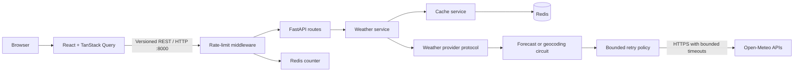

# Architecture

## Phase 5 runtime

The repository is a modular monorepo with independently testable web and API
applications. Docker Compose supplies a reproducible local environment while
each application can also run directly on the host.

## Boundaries

- `apps/web` owns browser rendering and frontend server state.
- `apps/api/app/api` owns versioned HTTP routing and dependency wiring.
- `apps/api/app/services` owns application use cases.
- `apps/api/app/cache` owns keys, serialization, freshness, metrics, Redis, and
  request coalescing.
- `apps/api/app/providers` owns the provider protocol and Open-Meteo translation.
- `apps/api/app/schemas` owns stable application-facing contracts.
- `infra/docker` owns container build definitions.
- `docs` records current behavior and decisions.

The service uses cache-aside reads. Fresh Redis values return immediately.
Stale weather values are retained but used only after a provider failure. Cache
I/O failures fall through to Open-Meteo. Same-key misses are coalesced within
each API process and recheck Redis after acquiring the lock.

The browser treats FastAPI as its only weather data source. TanStack Query owns
location and forecast request state and cancellation. The API remains canonical
in Celsius, km/h, and millimeters; pure frontend formatters apply the selected
display units without issuing redundant weather requests.

Transient provider calls are retried inside their operation-specific circuit.
One exhausted logical call records one circuit failure. An open circuit fails
fast until its recovery interval permits one half-open probe. `WeatherService`
continues to own the stale-data decision, so resilience transport policy cannot
silently serve stale location or expired weather data.

Rate limiting runs before versioned routes and uses an atomic Redis fixed-window
counter. If Redis fails, the limiter falls back to a process-local counter so a
cache outage neither disables the API nor removes all abuse protection.

